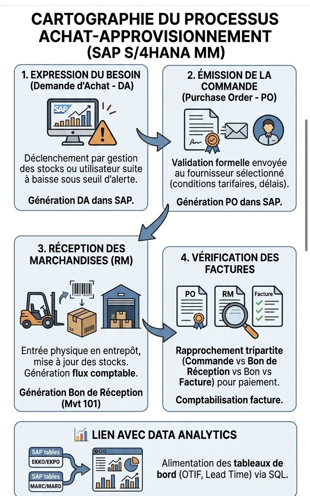

# 🌐 Cartographie des Processus SAP S/4HANA & Logistique

Ce document synthétise les grands flux transactionnels modélisés sous l'ERP SAP S/4HANA pour piloter la Supply Chain et la gestion des approvisionnements.

## 1. Processus Achat-Approvisionnement (SAP MM)
* **Étape 1 : Expression du besoin (Demande d'achat - DA)** : Déclenchement suite à une baisse de stock sous le seuil d'alerte.
* **Étape 2 : Émission de la Commande (Purchase Order - PO)** : Validation formelle et envoi au fournisseur sélectionné.
* **Étape 3 : Réception des Marchandises (RM)** : Entrée physique en entrepôt et génération du mouvement comptable (Mvt 101).
* **Étape 4 : Vérification des factures** : Rapprochement tripartite (Commande vs Bon de réception vs Facture).

## 2. Gestion des Stocks & Entrepôt (SAP WM / EWM)
* **Gestion des emplacements (Bins)** : Organisation physique et logique (réception, picking, stockage de masse).
* **Mouvements internes** : Transferts inter-entrepôts, régularisations d'inventaire et gestion des rebuts.
* **Traçabilité par lots (Batch Management)** : Suivi rigoureux des dates de péremption et numéros de série.

## 3. Pilotage de la Performance (Data Analytics)
* **Intégration des tables SAP** : Utilisation des tables transactionnelles (`EKKO`/`EKPO` pour les achats, `MARC`/`MARD` pour les stocks) pour alimenter les outils de Business Intelligence et les scripts SQL.
* **KPIs clés** : Suivi en temps réel du taux de service global (OTIF) et du respect des délais fournisseurs (Lead Time).
